<p align="center">
  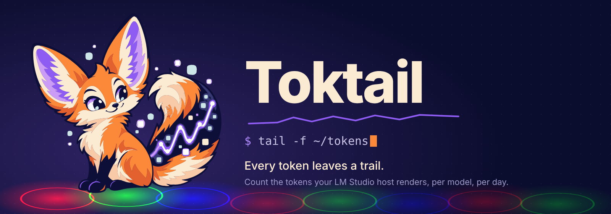
</p>

# Toktail


*Pronounced "tock-tail". A mix of **token** and `tail -f`.*

Toktail counts every token your LM Studio hosts render, input and output,
per model, per host, per day. It watches up to 17 hosts at once, writes one
CSV row per request, mirrors the files to an S3-compatible bucket, and shows
the history in a local portal you can leave open all day. If you want, it
also keeps the prompts and responses themselves (encrypted), so you can read,
search and re-run them, and it works out what your own hardware saves you
against public API prices over its lifecycle. Ask Pip anything about it, in
plain words, and one of your own models answers with the exact numbers. Pip
the Token Fox lives in your menu bar (or system tray) and in the portal:
napping when nothing is happening, munching while tokens stream, and losing
its mind when your models all start talking at once.

Toktail runs on macOS 11 and later (Apple Silicon and Intel), Windows 10 and
11 (x64 and ARM64), and Linux. A common setup: LM Studio on one AI-capable
machine, and Toktail on the older laptop you actually sit at, counting every
token that crosses the network.

<p align="center"></p>

## Meet Pip

Pip sits between your apps and LM Studio. Every request that passes through,
Pip catches the tokens, counts them, and adds them to the timeline. Its tail
is a real chart: the glowing line on it is your live tokens per second.

In the portal Pip is a living character, not a picture. It's drawn in vector
parts (body, head, two ears, four jointed legs and a flowing tail) in the
style of the mascot artwork, and animated live: a gallop where every paw is
placed on the ground with inverse kinematics, so feet plant instead of
sliding; a tail that streams and sways; blinking, ear twitches and breathing.

| When | Pip | In the menu |
|---|---|---|
| Nothing is streaming | Curls up and naps, eyes closed, breathing slowly | *Nothing to count. Nap time!* |
| Tokens are streaming | Runs along the trail, faster as throughput climbs, tail drawing the live chart | *Nom nom nom… 2,847 tokens/sec!* |
| Four or more requests at once, or three times your usual speed | Fur up, ears perked, tail puffed, flat-out sprint | *Holy tokens! We've got a stampede!* |

Every time one of Pip's paws touches the ground, that spot lights up in pure
red (`#FF0000`), green (`#00FF00`) or blue (`#0000FF`). The lights add up
where they overlap, the way real light does. Click Pip for a fact about your
tokens, double-click (or press `/`) to chat, or press **Replay the trail** to
watch Pip run across your history.

Pip also keeps you company while you read. Rest your pointer on a card and,
after a moment, Pip crouches, leaps up onto that card's top edge (via the
cards in between if it's far), and walks back and forth along it while
tokens flow, always on the side away from your pointer so it never covers
what you're reading. Scroll and Pip rides along with the card; scroll the card
away and Pip hops back down to the trail. It won't move more than every few
seconds, and it naps wherever it is when nothing is streaming.

<p align="center">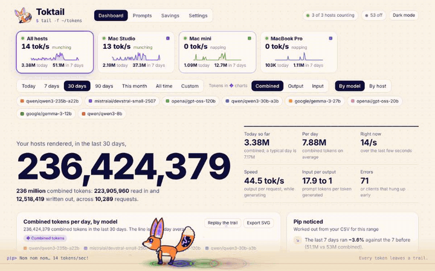</p>

## What you get

- **Many hosts, one dashboard.** Watch up to 17 LM Studio servers (this
  computer, a Mac mini in the closet, a remote box with an API token). Each
  host gets its own Toktail port. The dashboard shows every host as a live
  tile (status, tokens per second, today and the last 7 days), and you can
  look at all of them combined or click one (shift-click for several).
- **Public APIs too.** Add Anthropic, OpenAI or any OpenAI-compatible API as
  a host and point opencode, Claude Code, Codex, goose or roc at Toktail's
  port. The agent's own key passes through untouched and is never stored,
  logged or saved; the CSV only ever sees a one-way id of it. Or keep the
  provider key in your Keychain and hand each agent a **Toktail gateway key**
  that stands in for it, so the real key never leaves this computer. See
  [Public API hosts and keys](#public-api-hosts-and-keys).
- **Prompt cache.** Turn it on and an identical request (same host, body and
  credential) is answered from disk at once, encrypted, for 72 hours (yours
  to change); nothing runs. Hits are counted as their own rows, marked, and
  shown as tokens not generated.
- **Session chains.** Agents resend the whole conversation every turn. With
  saving on, each prompt is stored as only what's new plus a reference to
  the prompt it grew from, by path and checksum, in a per-session Merkle
  tree; opening one puts the bytes back exactly. Erase a link and the rest
  of the chain is refolded and verified before it goes.
- **Market prices.** Once a day Toktail fetches the public price lists from
  LiteLLM and OpenRouter (taking turns, no key needed), keeps the history and
  prices each request at the rates of its own day. A toggle prices the
  repeated prefix of agent prompts at the providers' cached-input rate.
- **Pip in 3D, and talking.** The same toon fox as toktail.dev, in three.js,
  with the live tokens/sec on the screen in its tail. When a coding agent
  works through an LM Studio host on your network, Pip asks that same model
  for one whimsical sentence about it and says it in a speech bubble (never
  for public APIs; nothing leaves your network). Press **u** or **Space** on
  the dashboard to ask Pip right away.
- **Chat threads.** Prompts → New chat keeps every conversation as its own
  thread, encrypted, with search, rename, pin and delete, apart from the
  proxy's prompt history. A Full screen button fills the view with just the
  chat, over a blurred page (your browser window is left alone); Esc
  twice sizes it back down.
- **Right now.** A live feed of every request streaming through your hosts
  (host, model, tokens so far, speed, how long it's been reading the prompt)
  and the ones that just finished, with refusals and errors flagged. Click one
  to open its record.
- **Ask Pip.** A chat that answers questions about your trail ("How many
  tokens did my laptop process last month?", "Which model is fastest this
  week?", "What would September have cost on Opus?") with one of your own
  models. Toktail works out the numbers from your CSV and shows them as cards
  next to the answer, so nothing is made up. Or switch to **Direct** and talk
  to a model with your own system prompt and nothing added.
- **Models.** A leaderboard of every model: speed, time to first token (median
  and slowest 5%), errors, refusals, work done and cloud value, a bubble chart
  of speed against wait, and a page per model.
- **Budgets and alerts.** Daily, weekly or monthly token limits for
  everything, one host or one model, with where each one is heading at
  today's pace. Pip taps you on the shoulder at 80% and at 100%, when a host
  stops answering and when it comes back (desktop notifications on macOS,
  Windows and Linux).
- **Combined, input and output.** Totals default to *combined* tokens (input +
  output). One switch changes the charts marked ◆ to output-only or
  input-only; hovering it lights up exactly the charts it affects, and every
  other card says what it always shows.
- **A hero number that fits.** "Your hosts rendered, in the last 7 days," is
  sized to fit anything up to 17 trillion (and beyond), exact to the token,
  with the words under it.
- **Signals.** Refusals and "worth a closer look" answers (code, structured or
  long) are spotted as they pass and counted on the dashboard. They're plain
  heuristics, not quality scores.
- **Menu bar or system tray.** Pip runs there while tokens stream and naps
  when they stop (or stays still, if you turn the animation off). The menu
  shows today's combined count, a per-host and per-model breakdown, your
  closest budget, S3 and host status, and links to the portal and to Pip.
- **A CSV you own.** One row per request, one file per month, with the host it
  ran on. Every number in the app comes from these files, and nothing ever
  deletes a count behind your back.
- **S3-compatible mirror.** CSV files, and saved prompts and responses if you
  want, go to Cloudflare R2, MinIO, Backblaze B2, Wasabi, AWS or your NAS.
- **Prompts (optional, off by default).** Save each request's prompt and
  response, encrypted at rest if you like, uploaded to S3, with rolling
  retention. Browse and search them, see how each one ranked, annotate,
  delete, and continue any of them in chat with its own system prompt.
- **Savings.** Track each machine (serial number, price, purchase date,
  lifecycle), see its rolling speed, lifetime tokens and a glowing lifecycle
  bar, and what it saved you month by month and year by year. Replace a
  machine when you upgrade and its history stays with it.
- **Cloud cost comparison (optional).** What the same tokens would have cost
  on Claude, GPT, Grok, Gemini, Perplexity, DeepSeek, Mistral and Kimi, against
  what your hosts cost: hardware share plus electricity.
- **The portal.** Five pages (Dashboard, Prompts, Models, Savings, Settings),
  a ⌘K palette to jump anywhere, keyboard shortcuts, Pip's intro, replay and
  platforming, insights, SVG export for every chart, CSV download for every
  table, light and dark mode, and **Today** / **Yesterday** / 7 / 30 / 90
  days / this month / all time / custom ranges.
- **Autopilot for coding agents.** roc (0.3 and later) publishes each
  opencode session's own server to this computer. On the **Agents** page, or
  by telling Pip "keep opencode going on the studio until I say stop",
  Toktail answers the agent whenever it goes quiet, in words you write: a
  firm "it isn't finished" when it says it's done, "continue" otherwise,
  optionally with a verifier's work list. Its questions come to you to
  answer. It runs until you stop it, and survives a restart. See
  [Autopilot](#autopilot).
- **API and MCP.** A documented REST API (OpenAPI 3.1) and an MCP server with
  the same operations, on their own port, behind keys you issue with
  scopes: Open WebUI, Claude Code or your own scripts can ask about your
  tokens and read your saved prompts and session chains. See
  [API and MCP](#api-and-mcp).
- **Pip's summaries.** Every prompt to a host on your network gets one
  sentence ("Sends back the output of go test, which has two failures."),
  written by the same model while it's idle, searchable on the Prompts page,
  and said in Pip's speech bubble, so you can watch what your agents do.
- **This computer.** Toktail's own memory, CPU and disk, and the host's
  memory, pressure, swap and CPU, live, in Settings.
- **Metrics.** A Prometheus endpoint at `/metrics`, on this computer only.

| Dark | Light |
|---|---|
| 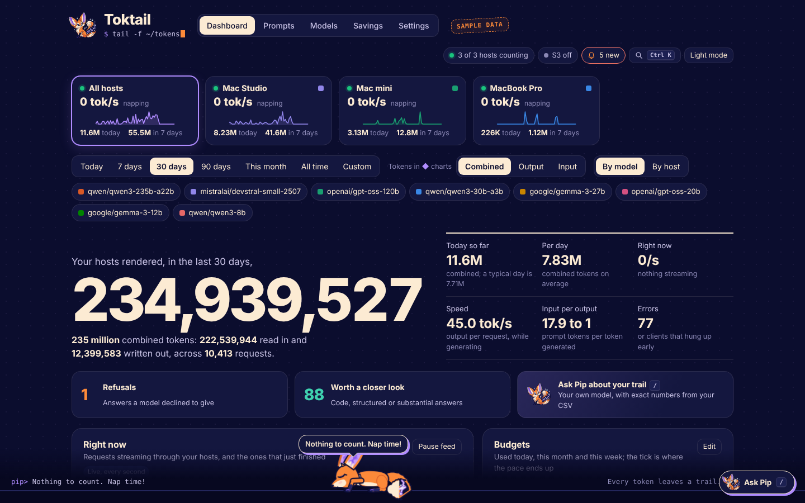 | 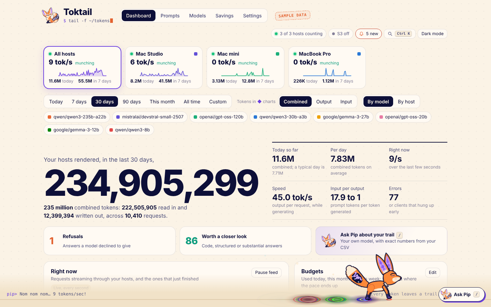 |

## Install

### macOS (Apple Silicon or Intel, macOS 11 or later)

Open Terminal and run:

```sh
git clone https://github.com/playandprosper/toktail
cd toktail
make demo
```

`make demo` installs what's missing (Apple's command line tools and Rust, the
first time only), compiles Toktail, and starts it with three pretend hosts
(a Mac Studio, a Mac mini and a MacBook Pro), 14 months of sample history,
the machines behind them, three budgets, and pretend traffic. Saving prompts
is on, with a random encryption key per file, so the Prompts page fills up as
you watch, and the pretend model answers Pip's questions from your sample
numbers. Pip appears in your menu bar and the portal opens at
http://127.0.0.1:8799. Your real data and Keychain entries aren't touched.
Press Ctrl-C to stop.

When you're ready to count your own tokens:

```sh
make install     # builds Toktail.app, copies it to /Applications and starts it
make settings    # add your LM Studio hosts: address, token, and the port apps call
```

`make dist` builds one universal `Toktail.app` (Apple Silicon and Intel) and
zips it, ready to copy to an older Intel Mac.

### Windows 10 and 11

Install Rust from [rustup.rs](https://rustup.rs) (the default setup, which
brings the Visual Studio build tools), then in PowerShell:

```powershell
git clone https://github.com/playandprosper/toktail
cd toktail
powershell -ExecutionPolicy Bypass -File scripts\build-windows.ps1 -Demo      # try it with sample data
powershell -ExecutionPolicy Bypass -File scripts\build-windows.ps1 -Install   # install and start it
```

`-Install` copies Toktail to `%LOCALAPPDATA%\Programs\Toktail`, adds a Start
menu shortcut and starts it. Pip lives in the system tray (click **^** if it's
hidden), secrets go to the Windows Credential Manager, and Toktail starts when
you sign in. Add `-Arm64` for ARM64 PCs. From Git Bash, the `make` commands
below work too.

### Linux

```sh
git clone https://github.com/playandprosper/toktail
cd toktail
make demo        # sample data in the browser
make install     # ~/.local/bin/toktail, with a tray icon if GTK is installed
make service     # or: headless, as a systemd user service (servers, LM Studio boxes)
```

For the tray icon install `libgtk-3-dev libxdo-dev libayatana-appindicator3-dev`
(Debian and Ubuntu names) before building; without them Toktail builds
headless. Either way the portal opens in your browser. The portal only answers on the machine it runs on: from another
computer use `ssh -L 8765:127.0.0.1:8765 host`.

### Commands

Run `make` on its own to see every command, and `make doctor` to check your
setup. Toktail turns on **Launch at Login** on first start (toggle it in the
menu).

| Command | What it does |
|---|---|
| `make demo` | Sample data and pretend traffic, nothing to set up |
| `make install` | Build, install and start Toktail |
| `make settings` | Hosts, saving prompts, encryption, S3, budgets |
| `make chat` | Ask Pip, or talk straight to a model |
| `make models` | Open the Models page |
| `make prompts` | Open the Prompts page |
| `make savings` | Open the Savings page |
| `make lmstudio` | Optional: move this computer's LM Studio to 1235 so apps keep 1234 |
| `make open` | Open the portal (signed in) |
| `make status` | What Pip is doing right now |
| `make logs` | Follow the log |
| `make s3-secret` | Save your S3 secret key in the Keychain / Credential Manager |
| `make dist` | Package for sharing (universal Mac app, Windows zip, Linux tarball) |
| `make service` | Linux: run headless as a systemd user service |
| `make uninstall` | Remove the app and login item, keep your CSV history |
| `make version` | Copy `VERSION` into `Cargo.toml` (after `bump`) |
| `make beta` | Next beta: `bump -beta -write`, then `make version` |

The portal opens signed in from the menu bar, `make open`, `make settings`
and the rest, or `Toktail open`. A browser you open some other way (a
bookmark, a typed address) shows how to get in; see
[Signing in to the portal](#signing-in-to-the-portal).

### Add your hosts

Open **Settings → Hosts** (or click the hosts pill at the top). Toktail starts
with one host, **This Mac** (**This PC** on Windows and Linux). For each host:

- **LM Studio's address**: where its server runs. This computer
  (`http://127.0.0.1:1235`) or another machine (`http://studio.local:1234`,
  `https://lm.example.com`).
- **API token**: only if that LM Studio asks for one. Toktail sends it as
  `Authorization: Bearer …` on every request to that host, replacing whatever
  key your apps send. It's saved in the Keychain (macOS) or Credential Manager (Windows), never in
  `config.toml`.
- **Toktail listens on port**: the port your apps call for this host. Every
  host has its own.
- **Let other devices on your network use it**: off keeps the port to this computer.

**Test connection** checks the address and token before you save. Changes
apply right away: ports open and close without a restart. Then point each app
at its host's `http://localhost:<port>/v1`. Up to 17 hosts.

<p align="center">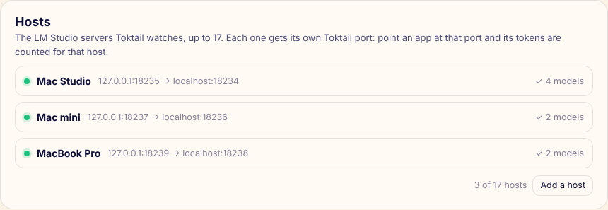</p>

### Public API hosts and keys

A host can also be **Anthropic**, **OpenAI** or **another OpenAI-compatible
API** (pick the type in Settings → Hosts). Point your coding agent at that
host's Toktail port and every token it spends is counted like any other,
with the model, the agent (opencode, Claude Code, Codex, goose, roc) and the
session. Nothing about how keys are handled is left to chance:

- **Your agent's own key passes through.** Whatever the agent sends
  (`x-api-key`, `Authorization: Bearer …`) goes to the provider exactly as it
  came and exists in Toktail only for the life of that request. It is never
  written to disk, never logged, and never shown in the portal. The CSV's
  `token_id` column holds a one-way id of it (`tk_` + 16 hex, an HMAC with a
  secret kept in your Keychain), so you can tell which key spent what without
  the key ever being recoverable from Toktail's files.
- **Or store the provider key once** in Settings → Hosts; it goes to the
  Keychain (macOS), Credential Manager (Windows) or the secret service
  (Linux), never to a file. Apps **on this computer** that send no key get it
  added (turn that off with *Add the stored key for apps on this Mac*).
  Apps on **other machines never get it**: a request from the network without
  a key is refused with 401, and Toktail never lends its stored key out.
- **Gateway keys** are how other machines (and apps you'd rather not hand the
  real key to) use the stored key. Issue one per agent in Settings → Hosts:
  it looks like `tkg_…`, you copy it once, Toktail keeps only a SHA-256 hash
  of it, and when an agent sends it Toktail swaps in the real key for that
  one request. Each gateway key has its own id in the CSV, can be marked
  usable from the network or only from this computer, and can be revoked at
  any time. Set it as `ANTHROPIC_AUTH_TOKEN`, `OPENAI_API_KEY` or
  `ROC_AI_API_TOKEN`, with the base URL pointing at Toktail's port.
- **Saved prompts and responses are scrubbed** of anything key-shaped
  (`sk-…`, `sk-ant-…`, `tkg_…`, `ghp_…`, `AKIA…`, bearer tokens) before they
  are written, and so are log lines.
- A provider key arriving from another machine over plain HTTP is noted once
  on the host's status line, with the suggestion to use a gateway key.
- Public hosts are checked with a request that counts 401 and 403 as
  "reachable" (the provider is there; the agents' keys do the rest), never
  raise "host down" alerts, and are left out of Pip's own model list and of
  the savings comparison (there's nothing local to compare).

Agent settings, for reference: Claude Code uses `ANTHROPIC_BASE_URL` and
`ANTHROPIC_AUTH_TOKEN`; roc passes `ROC_AI_API_TOKEN` by name and rewrites
loopback to `host.docker.internal`, so let the host's port accept your
network (or at least Docker's) in Settings; opencode, Codex and goose take
`OPENAI_BASE_URL` / `OPENAI_API_KEY` or their own provider settings. Apps can
also send `X-Toktail-Session`, `X-Toktail-Agent` and `X-Toktail-Project`
headers to name their session, agent and project; Toktail reads them and
strips them before forwarding.

### Prompt cache

**Settings → Prompt cache.** Off by default. When on, Toktail keys every
inference request by its host, endpoint, canonical body and credential id,
and stores complete, successful answers (encrypted like saved records, under
`cache/` in Toktail's folder) for 72 hours and up to 2 GB, both yours to
change. An identical request gets the saved bytes back at once, streams
replayed as streams, with `X-Toktail-Cache: hit`; nothing runs on any host.
Errors, refusals and cancelled requests are never cached. Apps skip the cache
with `Cache-Control: no-cache` or `X-Toktail-Cache: bypass`, and refresh it
with `X-Toktail-Cache: refresh`. Hits get their own CSV rows (`cache_hit` =
true, `usage_source` = cached) so your history stays complete; they don't
count toward budgets, live speed or electricity, and the dashboard shows them
as tokens not generated.

**Watching a remote LM Studio.** Run Toktail on your laptop, add the machine
that runs LM Studio as a host, and point your laptop's apps at Toktail. Your
requests go laptop → Toktail → remote LM Studio, and Toktail counts the
tokens in between.

**Keeping port 1234 on this computer.** If your apps already call
`localhost:1234`, move LM Studio to 1235 (`make lmstudio` does it with
LM Studio's `lms` command, or change the port in LM Studio's Developer tab)
and let Toktail listen on 1234.

## How tokens are counted

Toktail is a transparent reverse proxy in front of LM Studio. Every request is
forwarded unchanged, and on the way back Toktail reads the counts LM Studio
reports:

| Counter | Meaning |
|---|---|
| `input_tokens` | Prompt tokens LM Studio read (system prompt, history, new turn) |
| `output_tokens` | Tokens LM Studio generated |

Counted endpoints: `/v1/chat/completions`, `/v1/completions`, `/v1/embeddings`,
`/v1/responses`, `/v1/messages`, and LM Studio's native `/api/v0/*` and
`/api/v1/chat`. Model lists, model loading and everything else pass straight
through and aren't recorded.

For streamed chat and completion requests, Toktail asks LM Studio to add a
usage summary to the stream. If your app didn't ask for that summary itself,
Toktail removes it before the response reaches your app, so nothing changes
from the app's point of view. If LM Studio ever reports no usage, Toktail counts
the streamed pieces instead (about one token each) and marks the row
`estimated`.

**Not counted:** chats typed into LM Studio's own chat window. They never touch
the API server, so no proxy can see them.

## Privacy

The CSV never contains prompts, responses, client IP addresses or your host
names (hosts appear by the short id you gave them). Each prompt is stored only
as a SHA-256 fingerprint, which lets the portal spot repeated prompts without
being able to read them. If the CSV leaks, the worst that's exposed is model
names, counts, timings and fingerprints.

The fingerprint is the SHA-256 of the request's prompt fields (`system`,
`instructions`, `messages`, `prompt`, `input`, whichever are present), as
compact JSON with keys sorted. To check one against a request you have:

```sh
cat request.json | /Applications/Toktail.app/Contents/MacOS/Toktail fingerprint
```

A hash can't be reversed, but a short, guessable prompt (like "hi") can be
confirmed by hashing a guess and comparing.

Request bodies never go to the log. The portal listens on 127.0.0.1 only,
rejects any other `Host` or `Origin`, and loads nothing from the internet.
Secrets (API tokens, the S3 key, the encryption password, 1Password and Vault
tokens) live in the system's secret store (see [Command line](#command-line))
and are never sent back to the page; Settings
only shows whether one is saved.

## Saving prompts and responses

Off by default. Turn it on in **Settings → Saving prompts** and choose a
folder (**Choose…** opens the system folder picker). From then on, each counted
request leaves two files, named for the second it finished:

```
<folder>/<host>/2026/10/11/2026-10-11-14-03-22.prompt     the request, exactly as your app sent it
                           2026-10-11-14-03-22.response   the response (for streams: the text, reasoning and usage)
```

Each file is gzip-compressed, encrypted when encryption is on. (Two requests
in the same second get `-02`, `-03`…) The CSV row's `record` column points at
them; the prompt itself never goes in the CSV.

Agents send the same long prompt over and over, often to several models, so
the conversation itself (system prompt, messages, input) is stored once, under
`<folder>/blobs/`, named for its SHA-256, and each request's `.prompt` file
holds a sealed reference to it plus that request's own settings (model,
temperature, tools…). Reading or downloading a record puts the original
request back together exactly. A shared prompt and its key stay until the last
request that uses it is deleted.

### Session chains

Every turn of an agent conversation repeats nearly all of the turn before
it, so a blob is stored **folded**: only the bytes after the shared prefix,
behind two lines that say where the rest is:

```
{{toktail:chain v=2 session="s_7c…" node="…" parent="…" content="<sha256>" depth=7 prefix=48213 snapshot=false created="…"}}
{{toktail:ref path="blobs/3f/3f…e1.prompt" s3="records/blobs/3f/3f…e1.prompt" sha256="3f…e1" bytes="0-48213"}}
<the new bytes, verbatim>
```

The reference names the parent by path (and S3 key, with a mirror
configured), checksum and byte range. Opening a record puts the referenced
bytes in front of the new ones, hop by hop, and checks the result against the
content hash, so you get the request back byte for byte, line breaks and
all. Every 32nd link is a snapshot (the full content) so no prompt is more
than 32 hops from solid ground. The model never sees any of this: folding
happens after the answer is counted and saved, unfolding only when you open
a record; the request itself is forwarded exactly as the agent sent it (the
tests in `src/chain.rs` and `src/records.rs` prove both).

Each session is a Merkle tree: a node's id is the hash of its parent's id and
its own content hash, so a session id plus a branch tip commits to the whole
branch. A new prompt attaches to the node it shares the longest prefix with
(ties go to the closest), which is how an edited conversation becomes a
branch. Sessions come from the agent's `X-Toktail-Session` header, from a
chat thread, or from the prefix match itself. The header on every blob is
enough to rebuild the index (`<folder>/sessions/<id>.json`) from the files.
**Prompts → Sessions** lists them with what each saved and a tree of its
links; a record's page says where it sits. The CSV gets `session_id`,
`chain_node` and `prefix_tokens` (the repeated part, as tokens, pro rata).

**Erasing a link.** Delete a record and, if it was the last to use its
prompt, the prompt's children are refolded against its parent (or made
snapshots), each checked against its content hash, the index keeps a
tombstone, and only then does the file go and the row leave the page (it's
struck through until the chain is patched, then goes up in smoke). A blob
that vanished behind Toktail's back is marked missing instead, and its
descendants open with a `{{toktail:missing …}}` marker where the lost bytes
were.

**Coming from an earlier version:** twenty seconds after launch Toktail folds
every saved prompt into chains in the background, oldest first, checking each
one unfolds before replacing it. The originals are copied to
`<folder>/.pre-v0.0.3/` and stay readable until **Free space** on the
Sessions page removes them.

If a record's files disappear (you deleted them in Finder or Explorer, or
retention expired them here and in S3), Toktail notices and turns the row into
a count-only row. **The token counts always stay;** only deleting with "Also
remove from the token history" ticked removes a row.

With S3 on, the files are also uploaded to `<prefix>records/…`. Retention is a
rolling window you set separately for this computer and for S3: for example keep 90
days locally and 3 years in S3, or keep everything forever on your own MinIO.
A local file is only removed once it's safely in S3.

### Encryption

**Settings → Encryption** offers three modes:

| Mode | What happens |
|---|---|
| Off | gzip only |
| One password | Every file is encrypted (AES-256-GCM) with a key derived from your password (Argon2id) |
| Random password for every file | Every file gets its own random key, and Toktail keeps track of the keys in a secrets store |

For per-file keys, pick the secrets store:

1. **An encrypted file in Toktail's folder** (`keystore.tkt`), sealed with your
   password and mirrored to S3 next to the records.
2. **1Password**, one item per key in a vault, through the `op` command-line
   tool (with the 1Password app's sign-in, or a service-account token kept in
   the secret store).
3. **HashiCorp Vault**, one secret per key in a KV v2 engine (address, mount,
   path, optional namespace, and a token kept in the secret store).

Decryption is automatic: the Prompts page opens files from this computer, or
from S3 when the local copy is gone, and decrypts them on this computer only. Deleting a
record deletes its files here and in S3 and destroys its key. If encryption is
on but the key isn't available (no password yet, Vault unreachable), Toktail
keeps counting but saves nothing rather than write anything unencrypted, and
the Prompts page says why.

<p align="center">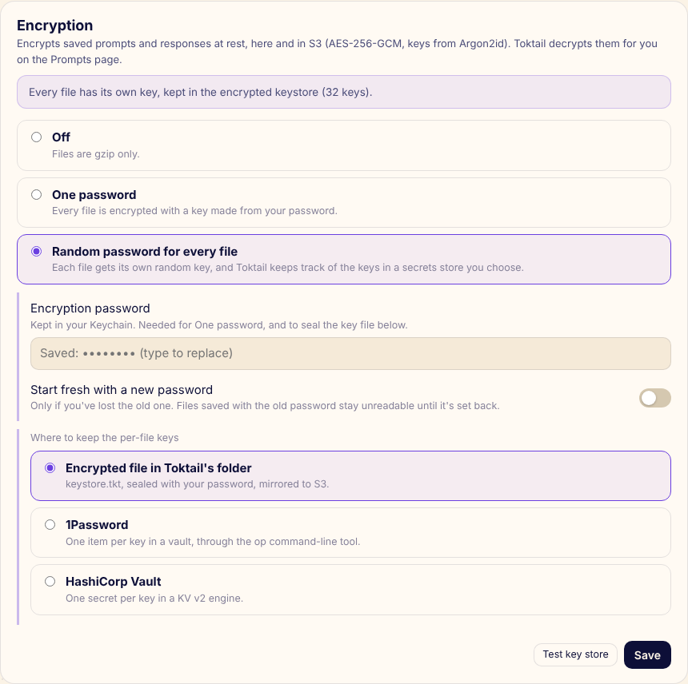</p>

### The Prompts page

<p align="center">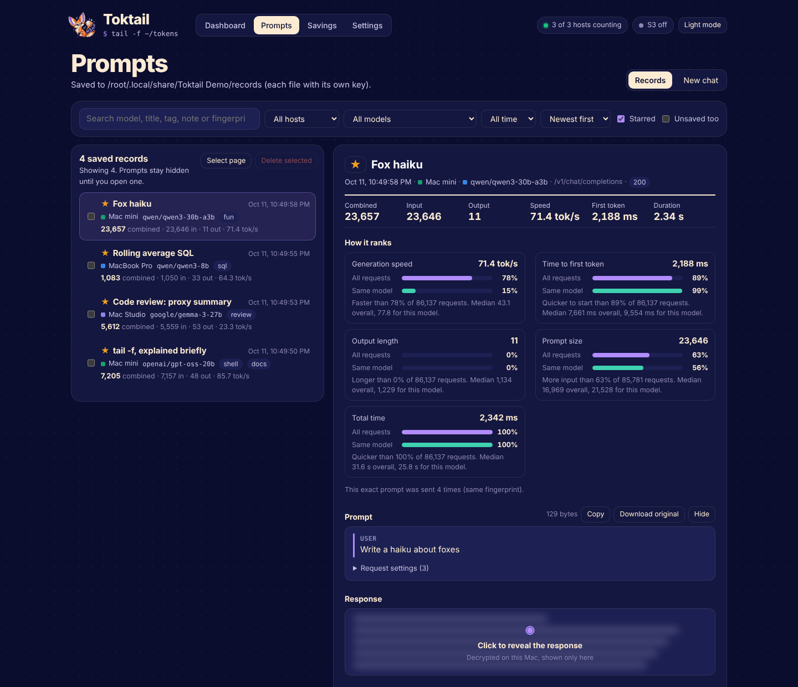</p>

- **Browse** every saved record by host, model, date, star or text (titles,
  tags, notes, model, fingerprint). It pages through the CSV on the server, so
  it stays quick with millions of records.
- **Read**: the prompt and the response are blurred until you click each one.
  Next to them: the token counts, speed, time to first token, and where this
  request ranks, as a percentile of every request and of the same model.
- **Annotate**: title, tags, notes and a star, kept sealed in `notes.tkt`.
- **Delete** one or many: the files go (here and in S3); tick a box to also
  remove the rows from the token history.
- **Filter** by signal: refusals (an explicit refusal from the API, or an
  answer that opens like one) and "worth a closer look" (code, JSON, tool
  calls, or long answers).
- **Continue in chat** picks up any saved record in Direct mode, with the
  record's own system prompt, turns and model, so it re-runs faithfully.

## Ask Pip

Press `/` anywhere, double-click Pip, or click **Ask Pip** in the corner. The
chat also has a full page (**Prompts → Chat**). Pick any model on any of your
hosts; the chat goes through that host's Toktail port, so it's counted (and
saved, when saving is on) like any other app's traffic.

**Pip mode** answers questions about your trail:

- *How many tokens did my laptop process last month?*
- *Which model is fastest this week, and which is slowest?*
- *Compare this week with last week.* (then *and the studio?*)
- *What would September have cost on Opus?*
- *Am I on track with my budgets?*
- *Show me the prompts the models refused to answer.*

Before your model sees the question, Toktail works out what it's about
(hosts by name, by machine or just "laptop"; models by name or family, like
"gemma"; periods like "last month", "this week", "last 30 days", "September",
"2026-09-01 to 2026-09-14") and computes the exact numbers from your CSV.
They go to the model as plain sentences, and to you as cards next to the
answer, so you can check every number Pip quotes. The model can also call
read-only tools for anything else: usage grouped by day, week, month, model
or host; period comparisons; per-model speed and errors; the biggest or
slowest requests; cloud prices; savings; budgets; what's live right now; and
searching and reading saved records. Short follow-ups (*and on Opus?*) carry
the previous question's scope. Models that don't take tools still answer
from the facts.

**Direct mode** sends only your messages and your system prompt, nothing
added. The **System prompt & settings** drawer holds the system prompt (in
Pip mode it replaces Pip's persona; Pip's rules for your numbers still
apply), temperature, a max-token limit, and whether to use your Toktail data.
The conversation is kept in this browser, so a refresh doesn't lose it.

<p align="center">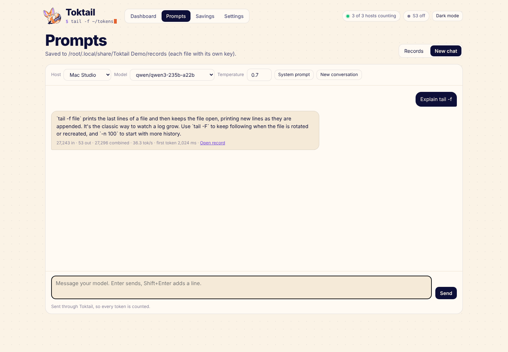</p>

## Models

Every model that ran through Toktail, for any range and host:

- **Highlights**: the fastest writer, the quickest to start, the one that did
  the most work, and the one with the most cloud value.
- **Speed against wait**: a bubble per model, speed across, time to first
  token down (lower starts sooner), size for work done.
- **Leaderboard**: requests, combined and output tokens, speed (output-weighted
  tokens per second while generating) and its fast end, time to first token
  (median and the slowest 5%), error rate, refusals, cloud value, a sparkline
  of daily tokens, and when it last ran. Sort by any column, split by host,
  download as CSV.
- **One model**: its numbers, tokens per day, and shortcuts to show only it on
  the dashboard, open its saved prompts, or ask Pip about it.

<p align="center">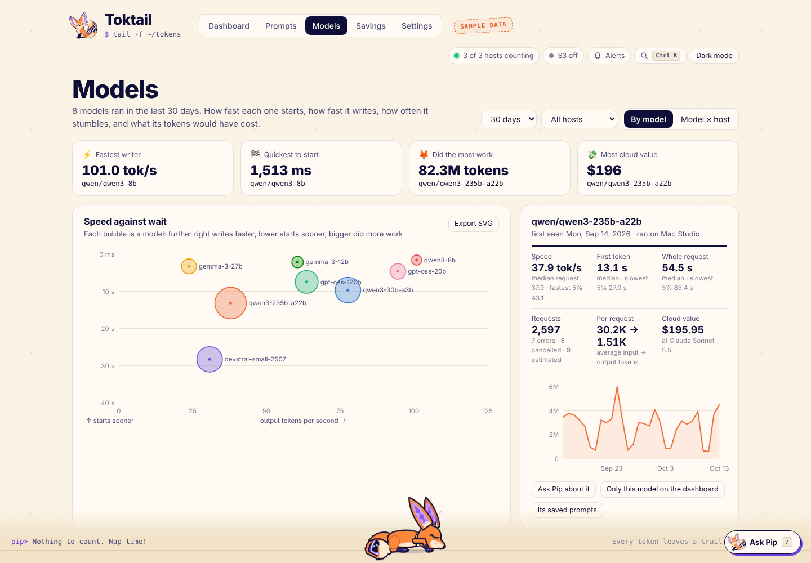</p>

## Right now, budgets and alerts

The **Right now** card shows every request in flight (which host and model,
tokens so far and their speed, or "reading the prompt" until the first token)
and a feed of the ones that just finished, with errors, refusals and
noteworthy answers tagged. Click a finished request to open it.

### When agents pile up

Coding agents stack requests on one machine: a long prompt is still being
read when the agent times out and sends it again, and subagents queue behind
each other. Every request on the Right now card can be steered:

- **Cancel.** Click **Cancel**, then **Sure? Cancel**. Toktail closes its
  connection to the model server, which stops the work there, and answers
  the agent with HTTP 499 (`toktail_cancelled`), which agents don't retry.
- **Reroute…** a request that hasn't sent anything back yet: pick another
  host, then a model *that host has* (the menu lists the models it reports
  right now; not every machine has every model, so the one the agent asked
  for is only offered where it exists). Toktail sends the same request there
  with that model, and the agent that sent it gets that answer on the same
  connection it's waiting on, as if the original host had answered. The
  response's `model` field names the model that really ran, and (when the
  answer hadn't started streaming yet) an `X-Toktail-Rerouted: studio ->
  laptop` header says where it came from. The agent's own API key never
  follows a request to another host: the target's stored key is used, or
  none. A rerouted answer isn't put in the prompt cache.
- **Use #N's answer** on a request tagged *retry of #N*: it stops, and its
  agent gets #N's answer, streamed from the first byte, when it comes.
- Tick several and **Reroute** or **Cancel** them together (subagents, say).

#### The same prompt, sent again and again

This one isn't Toktail's doing, and it isn't really the agent's either. LM
Studio reads one prompt at a time per model on a machine: it can *write*
several answers at once, but reading (prefill) is serial. Coding agents send
huge prompts for short answers (opencode routinely sends 600K-700K tokens to
get a few hundred back), so the reading is nearly all of the work, and extra
parallel slots don't help. If reading takes longer than the agent's timeout,
the agent gives up and sends the *same* prompt again, which lines up behind
the one still being read. A few timeouts later there are four copies in a
row, and the model would read the same 700K tokens four times.

Toktail notices and stops it, on its own (Settings → In flight):

- **It recognises the same input.** Two requests count as the same when
  they go to the same host, endpoint and model with the same key, and carry
  the same messages, system prompt, tools and response format. Sampling
  settings (`temperature`, `max_tokens`, seeds…) are ignored, since agents
  change those between retries.
- **The retry waits for the original instead of being read again.** The
  latest attempt is answered with the original's answer, streamed from its
  first byte, as soon as the original has one. The model reads the prompt
  once. The feed marks the retry *gets #1's answer · not read again*, and
  its CSV row is marked like a cache hit (`usage_source` = joined, note
  *answered by #1*), outside budgets.
- **The original keeps going when its agent hangs up** (for 3 minutes by
  default), because its retry is about to arrive. If no retry comes, Toktail
  stops it on the model server. If the original finishes before the retry
  arrives, the answer is kept for the rest of that time and handed to the
  retry as soon as it shows up.
- **Copies already running merge.** When the same prompt is already being
  read twice (it was sent before Toktail could match it, or matching was
  off), **Answer them with #N's answer** stops the later copies and gives
  their agents the oldest one's answer.

Above the list, a short diagnosis says what's happening in plain words, for
example:

> **Studio is reading 3 prompts for qwen3-coder, one at a time.**
> opencode sent the same ~608K-token prompt 4 times. opencode stopped
> waiting for #1 while it was still being read, and sent it again. #1 keeps
> going, and when it's done its answer goes to the latest attempt (#6). The
> retry isn't read again. 2 other prompts are waiting behind #1 (~89K more
> tokens to read); LM Studio will read them after it.
> [Send the waiting 2 to another machine…]
>
> Why: LM Studio reads one prompt at a time per model on a machine…

Each request in the line shows its place (*first in line*, *in line: 2 of
3*) and roughly how much prompt it has to read. **Reroute** is for the other
half of the problem: moving the prompts that are queued behind (subagents,
usually) to another machine.

While your pointer is over the list nothing moves: finished requests stay put,
greyed out, and new ones join at the bottom, so a button is never pulled out
from under a click.

The API behind it: `POST /api/flights/{id}/cancel`, `/reroute` (`{host,
model}`), `/join` (`{to}`), `/api/flights/bulk` and
`GET /api/flights/targets?endpoint=`; ids are the `#` numbers in `/api/live`.

**Budgets** (Settings → Budgets and alerts) are token limits per day, week
(Monday to Sunday) or month, for every host or one, every model or one, on
combined, input or output tokens. The dashboard shows each one's use and a
tick where today's pace ends up; the menu shows the closest one. Toktail
raises an alert once when a budget passes 80% and again at 100%, when a host
hasn't answered for a minute (and when it's back), and optionally when a
stampede starts. Alerts appear in the portal (the bell) and Pip says them;
with notifications on they also show as macOS, Windows or Linux desktop
notifications.

<p align="center">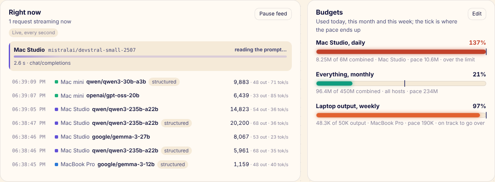</p>

## Command palette and shortcuts

`⌘K` (Ctrl-K on Windows and Linux) opens a palette: jump to any page,
settings section, host or model, change the range, run an action, search
saved prompts, or type a question and press Enter to ask Pip.

| Keys | Does |
|---|---|
| `⌘K` / `Ctrl-K` | Palette |
| `/` | Ask Pip |
| `g d`, `g p`, `g c`, `g m`, `g s`, `g ,` | Dashboard, Prompts, Chat, Models, Savings, Settings |
| `t` | Light or dark mode |
| `r` | Replay the trail |
| `?` | All shortcuts |

## Metrics and API

`http://127.0.0.1:8765/metrics` speaks Prometheus: tokens, requests, errors
and generation time per host and model (from the CSV), live tokens per
second, requests in flight, host health and budget use. It answers without
signing in (counts only). Scrape it from a Prometheus or Grafana Agent on
the same computer:

```yaml
scrape_configs:
  - job_name: toktail
    static_configs:
      - targets: ['127.0.0.1:8765']
```

The JSON behind the portal's pages needs the portal's sign-in. To build on
Toktail, use the public [API and MCP](#api-and-mcp) server instead: it is
documented, versioned and works with keys.

### Signing in to the portal

The portal listens on 127.0.0.1 only and refuses other websites, but every
program on this computer can reach 127.0.0.1, and that includes coding agents
in Docker containers (Docker Desktop forwards `host.docker.internal` to it).
So the portal needs a sign-in that only a browser you opened holds:

- The menu bar's **Open Toktail**, the first run, opening the app a second
  time, `make open` and `Toktail open [#/page]` write a one-time token to a
  folder only you can read and open `/login?t=…`. That sets an `HttpOnly`,
  `SameSite=Strict` cookie good for 30 days and takes you to the page.
- A login link works once and for two minutes. Only SHA-256 hashes of
  tokens and cookies are kept.
- `Toktail open --print` prints the link instead, for a browser on another
  computer through an SSH tunnel (`ssh -L 8765:127.0.0.1:8765 this-host`).
- **Settings → API & MCP → Sign out every browser** ends every sign-in.
- `/api/ping`, `/metrics` and `/api/status` (Pip's mood and speed, for
  `make status`) answer without signing in. They hold counts, never prompts.

## API and MCP

Toktail serves its data to other apps and AI clients on a port of its own
(8766; the demo uses 8798), separate from the portal:

- **REST** at `/api/v1/…`, plain `GET`s answering JSON. The OpenAPI 3.1
  document is at `/api/v1/openapi.json`.
- **MCP** at `/mcp` (Streamable HTTP, stateless, protocol versions
  2024-11-05 through 2026-07-28). Each REST operation is a tool with the same
  name and arguments.

Every request carries a key: `Authorization: Bearer tkm_…`. Issue keys in
**Settings → API & MCP**; **Connect a client** makes one and shows exactly
what to paste into Open WebUI, an OpenAPI tool or Claude Code. Toktail keeps
only a SHA-256 hash of each key. Each key has scopes:

| Scope | Operations |
|---|---|
| `read` | `usage_summary`, `compare_periods`, `model_stats`, `top_requests`, `cost_estimate`, `savings_summary`, `live_status`, `budget_status`, `list_hosts`, `list_coding_sessions` |
| `records` | `search_records`, `read_record`, `list_sessions`, `read_session` |

- A key works from this computer only unless you mark it usable from the
  network (and turn on **Let other machines connect**, which listens on
  every interface). Docker containers on this computer count as this
  computer, so keys, not addresses, are what keep an agent out.
- `read_record` returns where a prompt sits in its session chain (node,
  parent, depth, snapshot, bytes new at that link) and, by default, only the
  messages that turn added (`part=new`); `part=prompt` for the whole prompt,
  `part=response` for the answer.
- When saved records aren't encrypted, `records` keys get whole prompts and
  responses. When they are, they get metadata and short snippets unless you
  allow whole bodies in Settings (whatever reads them, Open WebUI included,
  stores them in its own, unencrypted, history).
- Every counting result says what it counted (`counted`: period, hosts,
  models), so an AI client that guessed an argument shows it.
- Nothing on the API changes Toktail or drives an agent.

Open WebUI (0.6.31 or later, as an admin): **Settings → Admin → Integrations
→ External Tool Servers → + Add Connection**, type **MCP (Streamable
HTTP)**, Server URL `http://host.docker.internal:8766/mcp` (Open WebUI in
Docker on this computer) or `http://<this computer>:8766/mcp`, Auth
**Bearer** with the key. Claude Code:
`claude mcp add --transport http toktail http://127.0.0.1:8766/mcp --header "Authorization: Bearer tkm_…"`.

```sh
curl -H "Authorization: Bearer $TOKTAIL_KEY" "http://127.0.0.1:8766/api/v1/usage?period=last%20week&group_by=host"
```

## Autopilot

Autopilot keeps a coding agent working until you tell it to stop. It works
with opencode sessions that [roc](https://github.com/andreimerlescu/roc)
(0.3 or later) runs: roc publishes opencode's own server on this computer's
loopback with a password per session, and Toktail reads where from roc's
`~/.local/roc/state.json` (Settings → Autopilot if yours is elsewhere).

Start it on the **Agents** page (each roc session is a card; open one and
press **Start autopilot**, with an optional goal), or ask Pip: *"keep
opencode going on the studio until I tell you to stop"*. Pip finds the
session by its label (Q #2), its project, or the host its model runs on.
Then, every few seconds:

- **Working:** nothing happens. If it stays busy with no new message for the
  silence time (10 minutes), you're told once, with what Toktail sees in
  flight for its model (a long prompt being read is normal).
- **Asked a question:** it's on the Agents page with the agent's options and
  a box to type your own answer, in the bell, and in a notification. Nothing
  else is sent until it's answered. If you don't answer in 15 minutes (or
  never, if you set 0), autopilot answers with your default answer and marks
  that it did.
- **Quiet for a minute:** autopilot sends the next prompt. When the agent
  said it's finished, that's your "done" template (by default a firm,
  specific "it isn't finished; finishing one file isn't finishing the task;
  keep going"); otherwise your "continue" template. Both are yours to edit
  in **Settings → Autopilot**, with `{{goal}}`, `{{verifier}}`, `{{turn}}`
  and `{{done_claims}}`.
- **A verifier** (optional) is a command run in the agent's container before
  each prompt, for example a script that lists the files that don't meet
  your skills yet. Its output goes into the prompt, so "not done" comes with
  a work list.

It stops when **you** stop it: **Stop after this turn** (the turn in progress
finishes), **Stop now** (aborts it), **End the roc session** (`roc -kill`),
or tell Pip "stop". On its own it only pauses or stops for things a person
has to fix, and tells you which: the same reply three times with no work in
between; three failed turns in a row, with what to fix (context window full,
the API key, opencode's 5-minute timeout, the model server down, the model
not loaded); or a prompt or token limit you set. If the agent writes
`NEED_HUMAN: <reason>`, you're told at once and autopilot keeps nudging
gently until you look. After five "I'm done" replies in a row you're told it
may be stuck, and it keeps going.

While autopilot drives, every page shows a banner (red when something needs
you). Runs are saved and resume after Toktail restarts. The Agents page also
shows the conversation, the agent's todo list, a box to write to the agent
yourself, and a log of everything autopilot sent and saw.

## Pip's summaries

For each prompt that goes to an LM Studio host on your network, Pip asks the
same model, while that model has nothing else in flight on that host, what
the prompt is, in one sentence. It reads only what's new in the prompt (the
messages after the model's last answer: your turn, or the tool results an
agent sends back) and the answer. The same prompt sent again is summarized
once. Summaries are kept with the request (sealed like saved records), shown
and searchable on the Prompts page, returned by the API, and said in Pip's
speech bubble so you can watch what your agents are doing. Public API hosts
are never asked. Turn them, or the bubbles, off in **Settings → Pip**.

## This computer

**Settings → This computer** shows Toktail's own memory, CPU, threads and
requests in flight, and the computer's memory in use, swap, CPU, load and
memory pressure (macOS's pressure level; on Linux, the time tasks stalled
on memory), sampled every 2 seconds and kept for an hour in memory, with
live charts. It also shows how much disk the history, saved records, cache,
summaries and market prices use.

## Savings and hardware

<p align="center">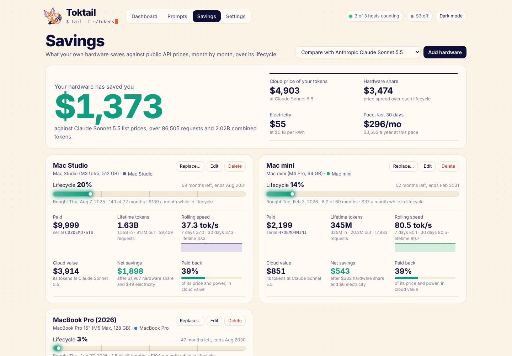</p>

Add each machine on the **Savings** page: name, model, serial number, the
price you paid, when you bought it, which host it serves, its power draw, and
its lifecycle (72 months by default; change the default in **Settings →
Hardware**, or per machine, to 96, 144 or whatever you plan). Toktail then
shows, per machine:

- a lifecycle bar that glows at how far along it is,
- what it costs per month while in its lifecycle (after that it's paid off),
- lifetime tokens, rolling speed over 7 days, 30 days and its whole life,
- the cloud value of its tokens, net savings, and how much of its price it
  has paid back.

Below, month by month and year by year: what your tokens would have cost at
the baseline service (and every other compared service), against your
hardware share and electricity, with a running total. When you upgrade, use
**Replace…**: the old machine retires on the new one's purchase date, keeps
its lifetime numbers, and the host's traffic counts toward the new one.

## Cloud cost comparison

Off by default. Turn it on in the portal under **Settings → Cloud cost
comparison**.

<p align="center">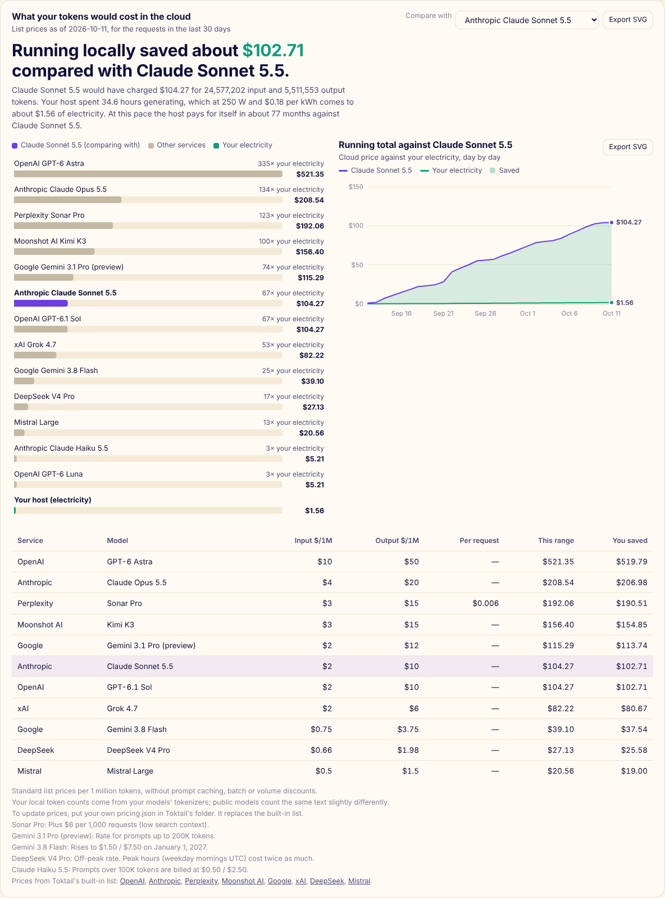</p>

For the selected date range and hosts, Toktail prices every request at each
service's public list price, using that request's own date and size (so
long-prompt tiers and scheduled price changes land on the right requests).
Your side is **what your hosts cost**: each machine's hardware share for those
days (its price spread over its lifecycle) plus electricity (the time your
hosts were actually generating, with overlapping requests counted once, times
the power draw and kWh price). The card shows the two side by side, then every
compared service, a running total, and a link to the full breakdown on the
Savings page.

Built-in prices, per 1 million tokens, as of 2026-10-11:

| Provider | Model | Input | Output | Notes |
|---|---|---|---|---|
| Anthropic | Claude Fable 5.1 | $10 | $50 | |
| Anthropic | Claude Opus 5.5 | $4 | $20 | |
| Anthropic | Claude Sonnet 5.5 | $2 | $10 | Default baseline |
| Anthropic | Claude Haiku 5.5 | $0.10 | $0.50 | $0.50 / $2.50 for prompts over 100K tokens |
| OpenAI | GPT-6 Astra | $10 | $50 | |
| OpenAI | GPT-6.1 Sol | $2 | $10 | |
| OpenAI | GPT-6 Luna | $0.10 | $0.50 | |
| xAI | Grok 4.7 | $2 | $6 | |
| Google | Gemini 3.1 Pro (preview) | $2 | $12 | Prompts up to 200K tokens |
| Google | Gemini 3.8 Flash | $0.75 | $3.75 | $1.50 / $7.50 from 2027-01-01 |
| Google | Gemini 3.5 Flash-Lite | $0.30 | $2.50 | |
| Perplexity | Sonar Pro | $3 | $15 | Plus $6 per 1,000 requests |
| Perplexity | Sonar | $1 | $1 | Plus $5 per 1,000 requests |
| DeepSeek | DeepSeek V4 Pro | $0.66 | $1.98 | Off-peak; peak hours cost 2× |
| DeepSeek | DeepSeek Flash | $0.15 | $0.60 | Off-peak; peak hours cost 2× |
| Mistral | Mistral Large | $0.50 | $1.50 | |
| Moonshot AI | Kimi K3 | $3 | $15 | |

Sources: [Anthropic](https://platform.claude.com/docs/en/about-claude/pricing),
[OpenAI](https://developers.openai.com/api/docs/pricing),
[xAI](https://docs.x.ai/docs/models),
[Google](https://ai.google.dev/gemini-api/docs/pricing),
[Perplexity](https://docs.perplexity.ai/getting-started/pricing),
[DeepSeek](https://api-docs.deepseek.com/quick_start/pricing),
[Mistral](https://mistral.ai/pricing),
[Moonshot AI](https://platform.kimi.ai/docs/pricing/chat).

Treat the numbers as a fair estimate, not a quote:

- They're standard list prices, without prompt caching, batch or volume discounts.
- Your token counts come from your local models' tokenizers. Public models
  count the same text a little differently.
- Embedding requests are left out.

Prices change. To use your own, put a `pricing.json` in Toktail's folder
(same format as [`assets/pricing.json`](assets/pricing.json)); it replaces
the built-in list.

## Configuration

`config.toml` is created on first run in Toktail's folder:
`~/Library/Application Support/Toktail` on macOS, `%APPDATA%\Toktail` on
Windows, `~/.local/share/Toktail` on Linux. **Edit Config…** in the menu opens
it; restart Toktail after editing by hand.
Changes made in the portal's Settings apply right away.

```toml
[[hosts]]                           # one block per LM Studio host, up to 17
id = "local"                        # short id used in the CSV and file paths
name = "This Mac"
upstream = "http://127.0.0.1:1235"  # where LM Studio listens
listen = "127.0.0.1:1234"           # what your apps call ("0.0.0.0:…" lets your network in)
enabled = true
# API tokens go to the Keychain / Credential Manager; set them in Settings → Hosts.

[portal]
port = 8765                         # always bound to 127.0.0.1
intro_animation = true              # Pip runs out from the middle on open
pip_roams = true                    # Pip runs the trail and hops onto cards

[storage]
data_dir = ""                       # empty = <Toktail folder>/data

[capture]
enabled = false                     # save prompts and responses
dir = ""                            # empty = <Toktail folder>/records
s3_upload = true
local_retention_days = 0            # 0 = keep forever
s3_retention_days = 0               # e.g. 1095 for three years

[encryption]
mode = "off"                        # "off", "password" or "per_file"
keystore = "file"                   # "file", "1password" or "vault"
onepassword_vault = "Toktail"
vault_addr = "http://127.0.0.1:8200"
vault_mount = "secret"
vault_path = "toktail"
# salt and key_check are generated; they aren't secret.

[s3]
enabled = false
endpoint = ""
region = "auto"
bucket = ""
prefix = "toktail/"
path_style = true
access_key_id = ""                  # the secret goes in the secret store, not here
sync_interval_minutes = 15

[app]
launch_at_login = true
show_count_in_menu_bar = true
animate_menu_bar = true             # false keeps Pip still in the menu bar
stampede_tokens_per_sec = 0.0       # 0 = three times your usual speed

[costs]
show_comparison = false
baseline = "claude-sonnet-5.5"
compare = []                        # empty = the default set
electricity_usd_per_kwh = 0.18
watts_while_generating = 250.0      # for hosts without a machine on the Savings page

[hardware]
default_lifecycle_months = 72

[[budgets]]                         # as many as you like; Settings → Budgets edits them
id = "studio-day"
name = "Mac Studio, daily"
host = "studio"                     # empty = every host
model = ""                          # empty = every model (a prefix like "qwen" works)
metric = "combined"                 # "combined", "input" or "output"
period = "day"                      # "day", "week" or "month"
limit = 50000000
notify = true                       # a desktop notification at 80% and 100%

[alerts]
budgets = true                      # budget warnings in the bell and as notifications
host_down = true                    # a host unreachable for a minute, and its recovery
stampede = false                    # unusually fast generation (at most every 10 minutes)

[api]                               # the API and MCP server (Settings → API & MCP)
enabled = true
port = 8766
allow_network = false               # listen on every interface, not just this computer
decrypted_bodies = false            # whole bodies for records keys even when records are encrypted
# [[api.keys]] entries hold only SHA-256 hashes; issue keys in Settings.

[autopilot]                         # Settings → Autopilot
roc_state = ""                      # empty = ~/.local/roc/state.json
grace_secs = 60                     # quiet this long before the next prompt
silence_minutes = 10
continue_template = "Continue. …"   # what it says; {{goal}} {{verifier}} {{turn}} {{done_claims}}
done_template = "I hear that you believe this is finished. …"
verifier_command = ""               # run in the agent's container before each prompt
max_turns = 0                       # 0 = until you stop it
token_ceiling = 0
repeat_limit = 3
error_limit = 3
done_claims_alert = 5
question_timeout_minutes = 15       # 0 = always wait for you
question_default_answer = "Use your best judgment: …"

[summaries]                         # Settings → Pip
enabled = true
bubbles = true                      # Pip says each summary instead of its commentary
max_queue = 200
```

The machines themselves are in `hardware.json` next to `config.toml`.
Upgrading from 0.3? Your single `[proxy]` section becomes the first host
automatically, and its API token moves with it.

### S3-compatible mirror

1. Fill in **Settings → S3 mirror** (or `[s3]` in config.toml):

   | Service | `endpoint` | `region` | `path_style` |
   |---|---|---|---|
   | Cloudflare R2 | `https://<account-id>.r2.cloudflarestorage.com` | `auto` | `true` |
   | MinIO / NAS | `http://nas.local:9000` | `us-east-1` | `true` |
   | Backblaze B2 | `https://s3.<region>.backblazeb2.com` | e.g. `us-west-004` | `false` |
   | Wasabi | `https://s3.<region>.wasabisys.com` | e.g. `us-east-1` | `false` |

2. Enter the secret access key in Settings (it goes to the secret store), or run
   `make s3-secret`. **Test bucket** writes, reads and deletes a small object.

3. Turn on **Mirror to S3**. The menu shows **S3: synced just now** when it
   works, or the error when it doesn't. No restart needed.

Each sync uploads only what changed:

```
<prefix>tokens-YYYY-MM.csv               the CSV, one file per month
<prefix>hardware.json                    your machines
<prefix>records/<host>/…/<stamp>.prompt  saved prompts and responses (if on)
<prefix>records/keystore.tkt             sealed per-file keys (if you use the key file)
<prefix>records/notes.tkt                sealed titles, tags and notes
```

The bucket is a copy; your Mac stays the source of truth. To restore on a new
Mac, copy the CSV files into the data folder (Toktail picks them up within
seconds) and the `.tkt` files into Toktail's folder; saved records are read
from S3 on demand.

After you rebuild the app, macOS may ask once whether Toktail can use the
Keychain item. Choose **Always Allow**. (Each build is ad-hoc signed, so macOS
sees it as a new app.)

## The CSV

One file per month, `tokens-YYYY-MM.csv`, one row per request:

| Column | Example | Notes |
|---|---|---|
| `request_id` | `d375dc0b-…` | random UUID |
| `timestamp` | `2026-10-11T14:03:22.123-07:00` | local time with UTC offset |
| `local_date` | `2026-10-11` | the day the row counts toward (local midnight) |
| `model` | `qwen/qwen3-30b-a3b` | as reported by LM Studio |
| `endpoint` | `/v1/chat/completions` | |
| `streamed` | `true` | |
| `status` | `200` | 499 means the client hung up mid-stream; 502 that LM Studio couldn't be reached |
| `input_tokens` | `3412` | |
| `output_tokens` | `918` | |
| `duration_ms` | `11873` | whole request |
| `ttft_ms` | `402` | time to first token (streams) |
| `output_tokens_per_sec` | `80.03` | output ÷ generation time |
| `usage_source` | `reported` | `reported`, `estimated` or `none` |
| `prompt_sha256` | `19e21ad5…` | fingerprint, see Privacy |
| `host` | `studio` | which host served it |
| `record` | `studio/2026/10/11/2026-10-11-14-03-22` | saved files, if saving was on |
| `outcome` | `complete` | `complete`, `refused`, `empty`, `error` or `cancelled` |
| `signal` | `structured` | `structured`, `substantial`, `tool_call`, `brief`, or for refusals `explicit_refusal` / `likely_refusal` |
| `response_chars` | `2048` | length of the answer text |
| `prompt_blob` | `5e1b…` | SHA-256 of the shared prompt, if saved |
| `prompt_key`, `response_key`, `reference_key` | `9f2c…` | ids (not keys) of the per-file encryption keys, so deleting a record destroys exactly its keys |

Files from earlier versions get the new columns added on first start (the
original is kept next to it as `tokens-YYYY-MM.csv.pre-v0.5.bak`).

Open the files in Numbers or Excel, or edit them by hand. Toktail re-reads any
file whose size or modification time changes, and matches columns by name.

## Command line

```
Toktail                  menu bar / system tray app (what the .app and Toktail.exe run)
Toktail --demo           sample data and pretend traffic (what make demo runs)
Toktail --headless       proxy, portal and S3 only, no menu bar or tray
Toktail --set-s3-secret  store the S3 secret key in the Keychain / Credential Manager
Toktail fingerprint      print prompt_sha256 for a request JSON on stdin
Toktail open [#/page]    open the portal, signed in (--print prints the one-time link)
```

`TOKTAIL_HOME` overrides the base folder. `TOKTAIL_S3_SECRET_KEY`,
`TOKTAIL_LMSTUDIO_TOKEN_<HOST ID>` (for example `TOKTAIL_LMSTUDIO_TOKEN_STUDIO`)
and `TOKTAIL_ENCRYPTION_PASSWORD` override the stored secrets.

| | Settings, CSV and records | Log when started at login | Secrets |
|---|---|---|---|
| macOS | `~/Library/Application Support/Toktail` | `~/Library/Logs/Toktail/toktail.log` | Keychain |
| Windows | `%APPDATA%\Toktail` | `%APPDATA%\Toktail\logs\toktail.log` | Credential Manager |
| Linux | `~/.local/share/Toktail` | `~/.local/share/Toktail/logs/toktail.log` (or `journalctl --user -u toktail`) | `~/.local/share/Toktail/secrets`, readable only by you |

## Coming from TokenLedger

Toktail's first release was called TokenLedger. On first start, Toktail moves
`~/Library/Application Support/TokenLedger` (config, CSV history, sync state)
to its new folder, removes the old login item, and still reads an S3 secret
saved under the old Keychain name. `build-app.sh --install` removes the old
app.

## Troubleshooting

- **Your apps get "Toktail could not reach LM Studio".** That host's LM
  Studio server isn't running at the address in Settings. **Test connection**
  says why. The host's tile on the dashboard shows the reason too.
- **"LM Studio wants an API token" / "refused the API token".** Add or fix the
  token in Settings.
- **A host shows "Can't listen on…".** Another app has that host's port.
  Pick a different port in Settings → Hosts.
- **Prompts aren't being saved.** The Prompts page says why at the top: usually
  encryption is on but its password or key store isn't set up yet.
- **Opening the app twice** just opens the portal of the running copy.
- **Counts look low.** Chats in LM Studio's own window aren't counted; only
  API traffic is.
- **Pip won't move.** Your computer is set to reduce motion, or **Let Pip
  roam** is off in Settings. Pip still reacts; it just stays put. To stop the
  menu bar animation only, turn off **Animate Pip in the menu bar**.
- **Pip is flat.** The 3D Pip needs WebGL and motion; with reduced motion or
  without WebGL the portal shows the SVG fox instead. Everything else works
  the same.
- **Pip never comments.** Commentary only happens for requests from a coding
  agent (opencode, Claude Code, Codex, goose, roc, or anything sending
  `X-Toktail-Agent`) to an LM Studio host on your network or this computer,
  with **Let Pip comment** on in Settings → Pip, at most once per the
  interval you set. Public API hosts never get commentary. **u** or **Space**
  on the dashboard asks for one right away (15 s between asks).
- **"Requests from other machines need a Toktail gateway key".** A public
  API host refuses network requests that carry no key. Give that machine a
  gateway key (Settings → Hosts) or let the agent use its own provider key.
- **Pip's answers say 0, or "No requests matched".** Pip shows the host and
  period it used on the card above the answer. If a host or model didn't
  match, the card says which hosts exist; ask again with one of those names.
- **Pip's chat says the model answered HTTP 400.** Some models reject tool
  calls; Toktail retries without tools automatically. If it still fails, try
  Direct mode to see the model's own error.
- **Windows: no Pip in the tray.** Click **^** next to the clock; drag Pip out
  to keep it visible. Toktail.exe started from a terminal prints its log there.
- **Linux: no tray icon.** Toktail was built headless (no GTK found) or your
  desktop has no AppIndicator support (GNOME needs the AppIndicator
  extension). The portal works either way.
- **"This browser isn't signed in to Toktail".** Open the portal from the
  menu bar (or `Toktail open`); a typed address or bookmark has no sign-in.
  `Toktail open --print` gives a link for a browser elsewhere.
- **The Agents page says it can't see roc's sessions.** Toktail reads
  `~/.local/roc/state.json`; set the path in Settings → Autopilot if your
  roc uses `-state`.
- **A session says "No remote control".** Autopilot needs roc 0.3 or later
  and opencode's TUI (`roc`, not `roc -- run …`), with
  `config.agent.remote_control` on in roc's state file. Sessions started
  before upgrading roc have to be restarted.
- **Autopilot stopped with "failed turns".** It names the cause and the
  fix; the most common is opencode's 5-minute request timeout on a big
  local model (raise `provider.<id>.options.timeout` in roc's
  `agents/opencode.json`).
- **An API client gets 401 or 403.** 401: no key, or a revoked one. 403: the
  key lacks the scope, or it's a "this computer" key used from the network.
- **No summaries.** They come only for LM Studio hosts on your network, and
  only while the model is idle; Settings → Pip shows how many are waiting.
- **Older Intel Mac.** Use `make dist` (or the CI's universal zip) on any Mac
  and copy `Toktail.app` over; it runs on macOS 11 Big Sur and later.

## Development

```sh
make test        # unit tests
make lint        # formatting and clippy, as CI runs them
make check-ui    # the portal scripts parse and their helpers behave (Node)
make run         # run from the source folder
TOKTAIL_HOME=/tmp/toktail-dev cargo run --no-default-features -- --headless
```

| Path | What it does |
|---|---|
| `src/proxy.rs` | One proxy per host: forwards traffic to LM Studio or a public API, handles keys and gateway keys, serves the prompt cache, runs each request as a steerable task (cancel, reroute, join), captures usage, hands bodies to records |
| `src/flights.rs` | Steering requests in flight: commands, the shared answer stream identical requests join, reroute targets, the API |
| `src/tokens.rs` | One-way token ids, gateway keys, private-address rules, scrubbing of key-shaped strings |
| `src/cache.rs` | The prompt cache: keys, sealed entries, TTL and size sweeps |
| `src/chain.rs` | Session chains: folded blobs with handlebars references, Merkle index, rebalancing deletes |
| `src/commentary.rs` | Pip's commentary: agent detection, rate limits, the one-sentence ask to the same local model |
| `src/market.rs` | Daily market prices from LiteLLM and OpenRouter, dated snapshots, matching to the price book |
| `src/threads.rs` | Chat threads: sealed per-thread files, index, API |
| `src/usage.rs` | Usage parsing, streamed text and prompt fingerprints |
| `src/ledger.rs` | CSV reading, writing and queries |
| `src/records.rs` | Saved prompts and responses: files, chains, S3, notes, retention, the pre-0.0.3 migration |
| `src/crypto.rs` | gzip, AES-256-GCM, Argon2id, key stores (file, 1Password, Vault) |
| `src/hardware.rs` | Machines, lifecycles and the savings report |
| `src/live.rs` | Live tokens per second, Pip's mood, and requests in flight / just finished |
| `src/pip_agent.rs` | Pip's chat: facts from the CSV, read-only tools, the streaming tool loop, Direct mode |
| `src/stats.rs`, `portal_insights.rs` | Per-model stats, budgets and alerts API, Prometheus `/metrics` |
| `src/budgets.rs` | Budgets, projections and alerts (budgets, hosts down, stampedes) |
| `src/intelligence.rs`, `src/retrieval.rs` | Refusal and noteworthy signals; the in-memory search over saved records |
| `src/platform.rs` | What differs between macOS, Windows and Linux: opening, folder picker, notifications |
| `src/pricing.rs`, `assets/pricing.json` | Cloud cost comparison |
| `src/s3sync.rs` | S3 mirror |
| `src/portal.rs`, `portal_records.rs`, `portal_settings.rs` | Local web server and API |
| `src/portal_auth.rs` | Signing in to the portal: one-time links, the cookie, the open paths |
| `src/api.rs` | The public API (`/api/v1`, OpenAPI) and MCP server (`/mcp`): operations, keys and scopes, the listener |
| `src/roc.rs`, `src/opencode.rs` | roc's sessions and control passwords; a client for opencode's own server |
| `src/autopilot.rs`, `src/portal_agents.rs` | Autopilot: the loop, decisions, templates, verifier, questions, stop and kill; the Agents page API |
| `src/summaries.rs` | Pip's one-line prompt summaries: queue, idle-only worker, sealed storage, search |
| `src/hoststatus.rs` | This computer: Toktail's and the host's memory, CPU, pressure and disk |
| `assets/agents.js` | The Agents page and the autopilot banner |
| `assets/index.html`, `app.css` | The portal's pages |
| `assets/common.js`, `dashboard.js`, `prompts.js`, `models.js`, `savings.js`, `settings.js`, `main.js` | Page code |
| `assets/pip-chat.js`, `palette.js` | Pip's chat (panel and page), the ⌘K palette and shortcuts |
| `assets/stage.js` | Pip's stage: intro, trail, replay, card platforming |
| `assets/pip.js` | Pip's animated rig: drawing, gait and IK, leaps, tail, moods, footstep lights |
| `assets/pip3d.js`, `pip-model.js`, `pip-clips.js`, `vendor/three.module.min.js` | Pip in 3D: the landing page's three.js model and clips, skinning the rig above |
| `assets/pip.svg` | The mascot artwork (logo, app icon, banner) |
| `src/tray.rs`, `assets/tray/` | Menu bar / system tray and Pip's run cycle |
| `src/demo.rs` | `--demo`: three hosts, sample history, hardware, pretend LM Studios and traffic |
| `src/login.rs`, `src/secrets.rs`, `src/config.rs` | Start at login (LaunchAgent, Run key, autostart), secrets, config |
| `scripts/build-app.sh`, `scripts/build-windows.ps1`, `packaging/` | Mac app (universal), Windows zip, Linux desktop entry and systemd unit |
| `.github/workflows/ci.yml` | Tests on macOS (Apple Silicon and Intel), Windows and Linux; packages all three |

See [CONTRIBUTING.md](CONTRIBUTING.md).

## License

Apache License 2.0. See [LICENSE](LICENSE) and [NOTICE](NOTICE).


